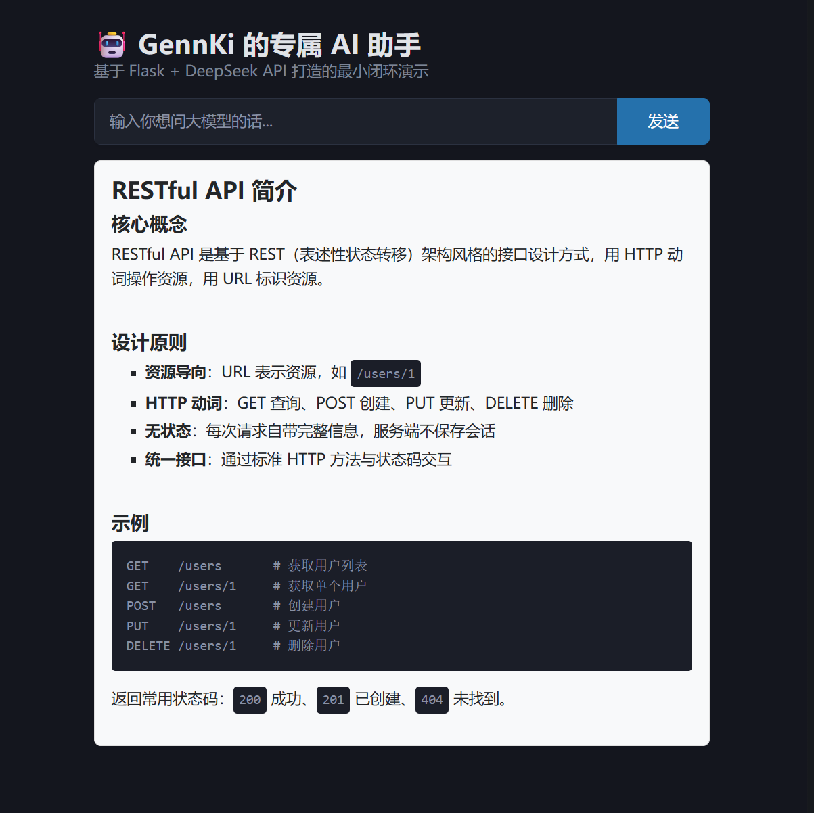

# Flask + DeepSeek 对话助手

基于 Flask 与 DeepSeek Chat API 的最小闭环演示：一个页面、一个接口，打通往返链路——前端输入 → 后端校验与转发 → 大模型回复 → Markdown 渲染上屏。



## 功能

- **单轮对话**：服务端组装 `system` / `user` 双角色消息，调用 `deepseek-chat` 返回回答

- **Markdown 渲染**：模型输出经 marked 解析为 HTML，再由 DOMPurify 净化后写入 DOM

- **分级错误提示**：按失败来源返回不同状态码，前端可区分"改输入"与"稍后重试"

- **Token 统计**：接口透传 `usage` 字段，为调用成本估算留出数据

## 技术栈

| 层 | 选型 |
| --- | --- |
| 后端 | Python 3 / Flask / Flask-CORS |
| 网络请求 | requests（统一 30s 超时） |
| 大模型 | DeepSeek API `deepseek-chat` |
| 前端 | 原生 Fetch API / marked.js / DOMPurify / Pico.css |

## 项目结构

```txt
FlaskAPI/
├── app.py                 # 唯一接口文件：校验、转发、错误分级
├── requirements.txt
├── templates/
│   └── index.html         # 单页前端：Fetch 请求、加载/成功/失败三态、渲染
└── static/js/
    ├── marked.min.js      # Markdown → HTML（本地化，规避 CDN 不稳）
    └── purify.min.js      # DOMPurify，剥离 <script>、onerror 等注入载体
```

## 快速开始

**1. 克隆并进入项目**

```bash
git clone https://github.com/gennki-mxh/gennki-ai-assistant-backend
cd gennki-ai-assistant-backend
```

**2. 创建并激活虚拟环境**

```powershell
# Windows PowerShell
python -m venv venv
.\venv\Scripts\Activate.ps1
```

```bash
# macOS / Linux
python3 -m venv venv
source venv/bin/activate
```

> PowerShell 若提示"禁止运行脚本"，执行一次 `Set-ExecutionPolicy -Scope CurrentUser RemoteSigned`；或用 cmd 运行 `venv\Scripts\activate.bat`。

**3. 安装依赖**

```bash
pip install -r requirements.txt
```

**4. 配置 API Key**

需要一个 DeepSeek API Key（[platform.deepseek.com](https://platform.deepseek.com) 获取）。

```bash
cp .env.example .env    # 然后填入你的密钥
```

> 密钥不入库，`.gitignore` 已排除 `.env`。

**5. 启动**

```bash
python app.py
```

访问 `http://127.0.0.1:5000`。

## 接口说明

### `POST /api/chat`

**请求体**

```json
{ "prompt": "你好，请自我介绍一下" }
```

**成功响应 `200`**

```json
{
  "status": "success",
  "data": {
    "reply": "你好！我是……",
    "usage": { "prompt_tokens": 15, "completion_tokens": 60, "total_tokens": 75 }
  }
}
```

**错误响应**

```json
{ "status": "error", "msg": "Prompt 不能为空" }
```

**状态码设计**

| 状态码 | 触发条件 | 前端应对 |
| --- | --- | --- |
| `400` | prompt 为空 / 超过 2000 字符 | 修改输入后重试 |
| `500` | 服务端未配置 `DEEPSEEK_API_KEY` | 提示联系维护者，重试无效 |
| `504` | 上游响应超时（30s） | 稍后重试 |
| `502` | 上游连接失败 / 返回非 200 / 响应结构异常 | 稍后重试 |

分级的目的：让前端能判断"这是我该改的"还是"这是等服务恢复的"，而不是统一弹一句"出错了"。

## 实现要点

1. **密钥不落库**：`os.environ` 读取，缺失时在接口层直接返回 `500` 并给出明确原因，而不是让请求发出去才炸。
2. **输入校验前置**：非空 + 长度上限（2000 字符）双重校验，避免无效请求打到上游产生费用。
3. **异常分层捕获**：`requests.Timeout` → `504`，`requests.RequestException` → `502`，上游非 200 与 JSON 结构缺失（`KeyError` / `IndexError`）→ 各自 `502`，不让异常穿透成 500 堆栈。
4. **前端三态**：发送后立即置"思考中"占位并清空输入框，成功渲染、失败展示可读文案，避免用户重复点击。
5. **渲染净化**：模型输出属于不可信内容，`DOMPurify.sanitize(marked.parse(...))` 之后才进 `innerHTML`；页面自身的固定文案则直接赋值。

## 已知限制

这是有意收敛到最小闭环的演示，以下为已知边界：

- 无多轮记忆：每次请求只携带当前一条 `user` 消息
- 非流式：需等待完整响应，长回答时首字延迟明显
- 无持久化：刷新页面即丢失对话
- `debug=True` 仅用于本地开发，部署需改用 WSGI 服务器（如 gunicorn）

---

Created by [GennKi](https://gennki-mxh.github.io/)
